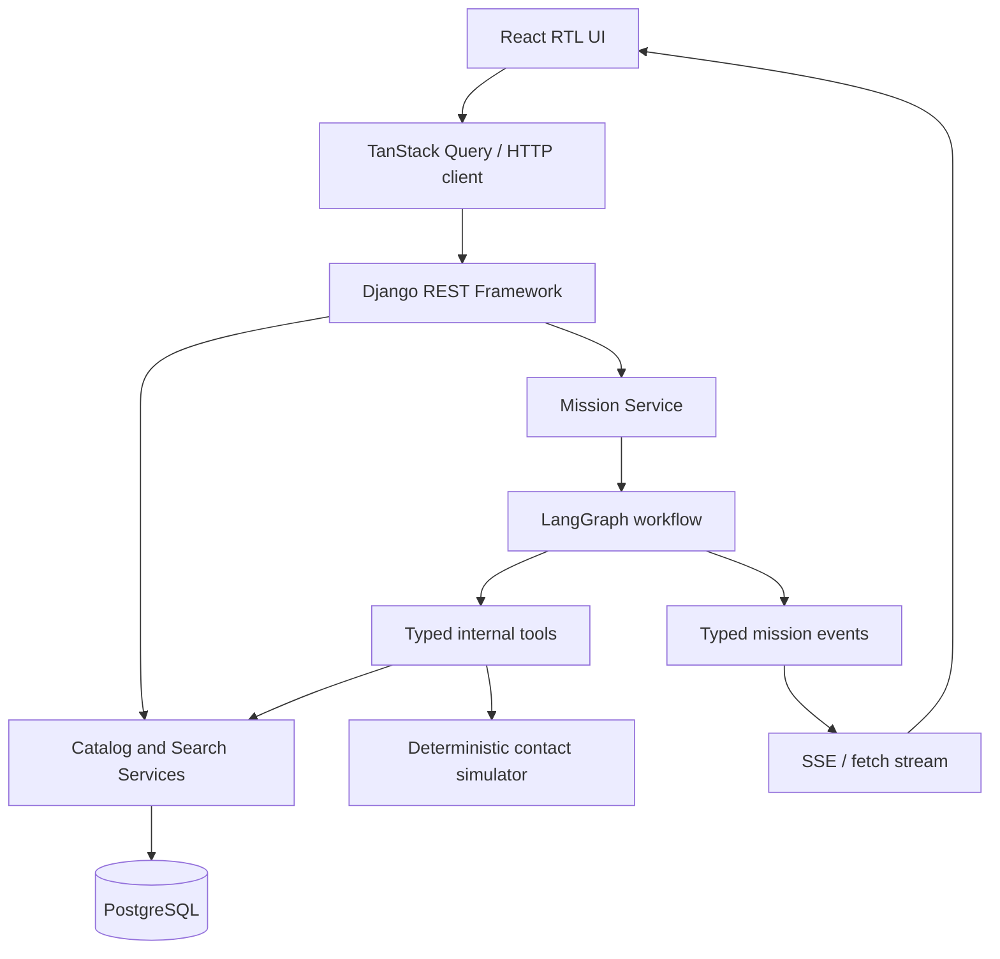

# معماری سیستم

**وضعیت:** معماری هدف. تطبیق با کد باید پس از پیاده‌سازی ثبت شود.

## 1. اصول معماری

- monolith ماژولار: یک Django backend و یک React frontend.
- PostgreSQL منبع قطعی همه محصولات، فروشگاه‌ها و آفرهاست.
- عامل ابزارهای داخلی محدود را صدا می‌زند؛ دسترسی مستقیم به SQL آزاد یا ابزار اجرایی دلخواه ندارد.
- هر بخش قابل‌تست و جایگزین‌پذیر است؛ ولی سرویس و دیتابیس جدا فقط وقتی اضافه می‌شود که اندازه‌گیری نیاز را ثابت کند.
- درخواست‌های deterministic (جست‌وجو، مرتب‌سازی و تغییر فیلتر) مستقیماً API را صدا می‌زنند.

## 2. نمای منطقی

## 3. مسئولیت لایه‌ها

### Frontend

- React + TypeScript + Vite.
- feature-first organization: search, products, shops, missions.
- TanStack Query برای داده سرور، cache و cancellation؛ state رابط کوتاه‌عمر برای پنل باز/بسته و فرم فیلتر.
- registry کامپوننت‌های مولد براساس union نوع‌دار؛ داده اصلی توسط API معتبرسازی می‌شود.
- فونت فارسی، `dir="rtl"`, کنترل فوکوس، حالت loading/empty/error و طراحی responsive.

### API و سرویس‌های Django

- Serializer/schema ورودی و خروجی.
- خدمات دامنه برای import، جست‌وجو، eligibility، رتبه‌بندی و برنامه مراجعه.
- ORM/SQL parameterized؛ هیچ SQL ساخته‌شده توسط LLM.
- مدیریت خطا و logging ساختاریافته با request ID و mission ID.

### Agent

- یک LangGraph با state محدود و nodeهای قابل‌ردیابی.
- graph وظیفه تصمیم درباره مرحله بعد را می‌گیرد؛ منطق قطعی در services/toolهاست.
- مدل/ارائه‌دهنده از adapter تنظیمات محیطی گرفته می‌شود.
- tool output شامل داده نوع‌دار و منبع است.

### Database

- `Product`, `Shop`, `Offer`؛ شناسه‌های منبع unique حفظ می‌شوند.
- `PurchaseMission`, `MissionEvent`, `ContactAttempt` برای جریان مأموریت.
- JSON منبع در جایی که انعطاف لازم است حفظ می‌شود؛ ستون‌های پرکاربرد جست‌وجو/فیلتر نرمال یا ایندکس می‌شوند.

## 4. مدل دامنه پیشنهادی

### Product

- `source_id`، `persian_title`، `brand_name` nullable، `category_name` nullable، `model` nullable، `specs` JSON، `image_urls` JSON، زمان ورود به دیتابیس.

### Shop

- `source_id`، `name`، `category_names` JSON، `address`، `location_label`، `lat`، `lon`، `contacts` JSON، `payment_options` JSON، `weekly_hours` JSON، `website_url`، `instagram`، `supports_fast_delivery` nullable bool.
- کل مجموعه ورودی برای تهران انتخاب شده؛ فیلد city مستقل در CSV نیست. این فرض در کد باید در سطح مجموعه داده مستند باشد، نه اینکه از نام فروشگاه شهر استخراج شود.

### Offer

- `source_id`، FK به Product و Shop، `price_toman` Decimal یا nullable، `last_price_changed_at` nullable timezone-aware، `seller_title`، `description`، `warranty` JSON nullable.
- `offer_id` نباید صرفاً بر اساس ترکیب محصول/فروشگاه حذف یا ادغام شود.

### PurchaseMission

- UUID، session/user anonymous key در صورت نیاز، current stage/status، structured constraints، preferences، selection IDs، created/updated timestamps.
- از ذخیره غیرضروری اطلاعات شخصی یا تاریخچه طولانی اجتناب شود.

### MissionEvent

- mission FK، monotonically increasing sequence، event type، schema version، safe payload، created_at.
- event payload نباید کلید مخفی، prompt داخلی یا اطلاعات شخصی غیرضروری شامل شود.

### ContactAttempt

- mission، shop/offer مرجع، scenario key سروری، result enum، started/finished timestamp، user-facing summary و simulator version.
- کلاینت اجازه انتخاب نتیجه تماس را ندارد؛ فقط درخواست اجرای استعلام/سناریوی مجاز را می‌فرستد.

## 5. داده و منبع حقیقت

- فایل CSV منبع خام است؛ هیچ فایل import‌شده دستی دستکاری نشود.
- رکورد product/shop/offer فقط با شناسه source وصل می‌شود.
- مبلغ در دیتابیس Decimal/Numeric و در JSON به رشته عدد صحیح تومان ارائه می‌شود.
- نرمال‌سازی جست‌وجو یک مسیر مشترک و تست‌شده است؛ مقدار اصلی برای نمایش حفظ می‌شود.
- تمام محاسبات فاصله با مختصات WGS84 و فرمول/کتابخانه مشخص انجام می‌شوند. فاصله مستقیم با زمان مسیر پیاده‌روی یکی نیست.

## 6. انتخاب دیتابیس و ایندکس

PostgreSQL منبع حقیقت نسخه اول است. ایندکس‌های اولیه:

- unique روی source ID هر موجودیت.
- FK و index روی `Offer.product_id`، `Offer.shop_id`.
- index روی price و timestamp در صورت استفاده در query plans.
- `pg_trgm` برای fuzzy search و PostGIS برای distance فقط در صورت پشتیبانی و benchmark.
- اگر `specs` JSON جست‌وجوی پرتکرار لازم پیدا کرد، بر اساس پروفایل واقعی آن را denormalize/index کنید؛ در شروع تمام فیلدهای specs را ستون جدا نکنید.

## 7. مرز مدل زبانی

مجاز: تفسیر متن، استخراج نیاز، پرسیدن سؤال، انتخاب ابزار از whitelist، خلاصه‌سازی نتایج و توضیح دلیل پیشنهاد بر اساس evidence.

غیرمجاز: SQL دلخواه، تغییر شروط سخت بدون اجازه، اختراع قیمت/فاصله/موجودی/ساعت، انتخاب نتیجه تماس از طرف کاربر، اجرای کد تولیدی، یا اعلام موفقیت ابزاری که شکست خورده است.

## 8. عملکرد و پایداری

- در مسیر جست‌وجوی اصلی LLM صدا زده نمی‌شود.
- پاسخ‌ها محدود و صفحه‌بندی می‌شوند؛ تصاویر lazy load می‌شوند.
- N+1 query با `select_related`/`prefetch_related` و profiling بررسی شود.
- هر external call timeout و fallback دارد.
- برای stream، mission snapshot یا آخرین sequence باید امکان بازیابی وضعیت فراهم کند؛ قطع UI نباید مأموریت را از بین ببرد.
- سرویس اضافی فقط با benchmark یا نیاز پذیرش اضافه شود.

## 9. مشاهده‌پذیری

Log ساختاریافته باید حداقل request ID، endpoint، elapsed ms، نتیجه/تعداد، نوع خطا و mission ID را ثبت کند؛ prompt کامل/کلیدها در log نرود. برای graph، node start/end، نام tool، duration و success/failure ثبت شود. trace نباید اطلاعات حساس را بی‌دلیل نگه دارد.
